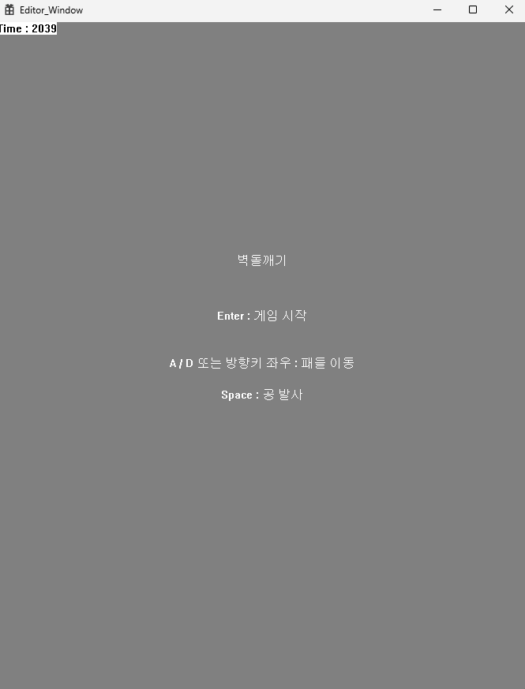
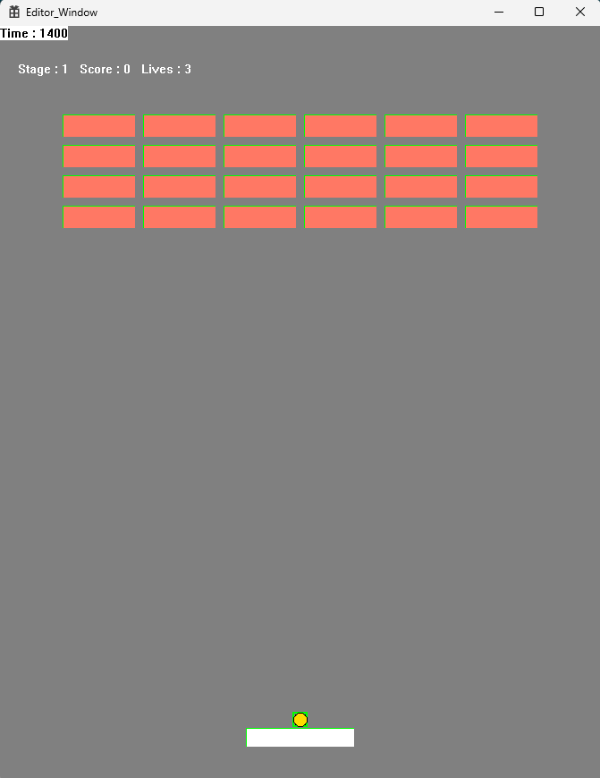
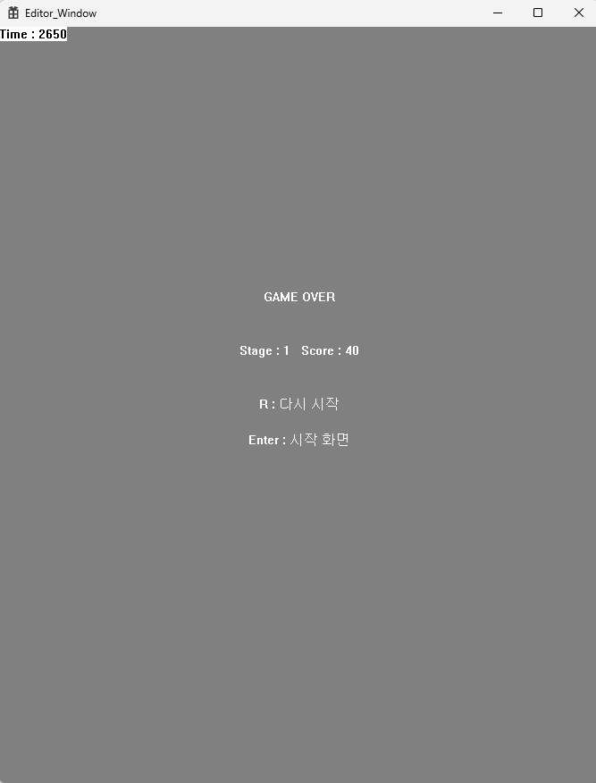
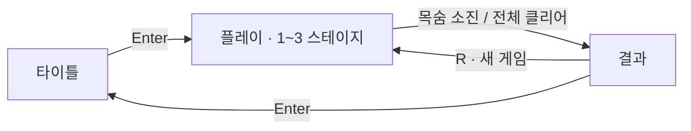
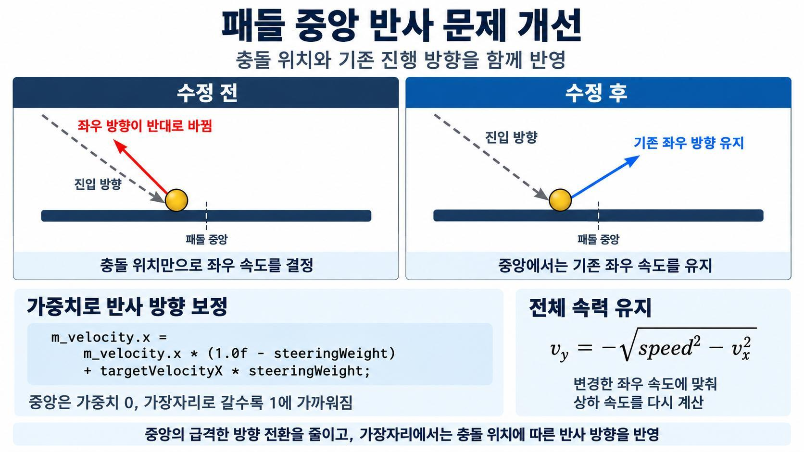

<div align="center">

# 🧱 벽돌깨기 · Breakout

**C++ / WinAPI 기반 2D 게임 학습 프로젝트**

공개 엔진의 구조를 이해하고, 게임의 동작과 진행 흐름을 구현했습니다.

`C++20` · `WinAPI / GDI` · `Visual Studio 2022` · `Git`

[미리 보기](#preview) · [게임 기능](#features) · [구현 구조](#architecture) · [문제 해결](#reflection) · [실행 방법](#getting-started)

</div>

---

## 프로젝트 소개

패들을 움직여 공을 튕기고, 화면의 벽돌을 모두 파괴하는 벽돌깨기 게임입니다. 3개의 스테이지를 진행하며 점수와 목숨을 관리하고, 게임 종료 후 다시 시작할 수 있습니다.

**학습의 중심은 C++ 객체지향 구조와 게임 로직 구현입니다.** 기존 엔진의 씬·컴포넌트·입력·충돌 기능을 활용하면서 객체별 역할을 구분하고, 실제 플레이에서 발견한 반사 동작의 문제를 계산 로직으로 분석해 개선했습니다.

| 항목 | 내용 |
| --- | --- |
| 개발자 | 정찬빈 |
| 실행 환경 | Windows |
| 개발 도구 | Visual Studio 2022, MSVC v143, Windows SDK, Git |
| 언어·그래픽 | C++20, WinAPI, GDI / GDI+ |
| 게임 코드 | [`opEngine_Window`](opEngine_Window) |
| 실행 프로젝트 | [`Editor_Window`](Editor_Window) |
| 기반 엔진 | 공개 C++/WinAPI 엔진 [YamYam_Engine](https://github.com/eazuooz/YamYam_Engine) |

<a id="preview"></a>

## 미리 보기

| 타이틀 | 플레이 | 결과 |
| :---: | :---: | :---: |
|  |  |  |


<a id="features"></a>

## 게임 기능

### 조작 방법

| 화면 | 키 | 동작 |
| --- | --- | --- |
| 타이틀 | `Enter` | 새 게임 시작 |
| 플레이 | `←` / `→` 또는 `A` / `D` | 패들 좌우 이동 |
| 플레이 | `Space` | 공 발사 |
| 결과 | `R` | 새 게임으로 재시작 |
| 결과 | `Enter` | 타이틀로 이동 |

### 규칙과 진행

- **공 이동과 반사:** 공이 좌우 벽·천장·패들·벽돌에 닿으면 반사합니다. 발사 전에는 공이 패들을 따라 움직입니다.
- **점수:** 벽돌 하나를 파괴할 때마다 10점을 얻습니다.
- **목숨:** 3개로 시작하며, 공을 화면 아래로 놓치면 1개 줄어듭니다. 남은 목숨이 있으면 공을 다시 발사할 수 있습니다.
- **스테이지:** 현재 스테이지의 벽돌을 모두 파괴하면 다음 스테이지로 넘어갑니다.
- **종료:** 목숨을 모두 잃으면 `GAME OVER`, 3개 스테이지를 모두 완료하면 `ALL CLEAR`를 표시합니다.
- **재시작:** 점수·목숨·스테이지와 공·패들 위치를 초기화하고, 남은 벽돌을 정리한 뒤 1스테이지의 벽돌을 생성합니다.

| 스테이지 | 벽돌 배치 | 벽돌 수 |
| :---: | :---: | :---: |
| 1 | 4행 × 6열 | 24개 |
| 2 | 5행 × 6열 | 30개 |
| 3 | 6행 × 6열 | 36개 |



<a id="architecture"></a>

## 구현 구조

### 기존 엔진의 활용과 게임 구현 범위

| 기존 엔진에서 활용한 기능 | 게임에 맞게 구현한 내용 |
| --- | --- |
| 씬·레이어·컴포넌트 구조 | 타이틀·플레이·결과 씬 구성 |
| 입력·시간·렌더링 처리 | 패들 조작, 공 이동, 게임 정보 표시 |
| 콜라이더와 충돌 이벤트 | 공의 반사와 벽돌 파괴 로직 |
| 객체 생성·삭제 기능 | 벽돌 배치, 스테이지 전환, 재시작 시 객체 정리 |

공은 원형으로 그리지만, 게임에서 공·패들·벽돌의 충돌 영역은 `BoxCollider2D`로 설정했습니다. 충돌 이벤트를 전달받은 뒤 게임 스크립트에서 반사와 파괴 동작을 처리합니다.

### 클래스별 책임

| 클래스 | 담당 역할 | 코드 |
| --- | --- | --- |
| `TitleScene` | 시작 화면, 조작 안내, 게임 시작 | [보기](opEngine_Window/opTitleScene.cpp) |
| `PlayScene` | 공·패들·벽돌 생성, 점수·목숨·스테이지 관리, 재시작 | [보기](opEngine_Window/opPlayScene.cpp) |
| `ResultScene` | 클리어·게임 오버 결과 표시, 재시작과 타이틀 이동 | [보기](opEngine_Window/opResultScene.cpp) |
| `BallScript` | 공 발사·이동, 충돌 반사, 화면 아래 이탈 처리 | [보기](opEngine_Window/opBallScript.cpp) |
| `PaddleScript` | 패들 이동과 화면 경계 제한 | [보기](opEngine_Window/opPaddleScript.cpp) |
| `BrickScript` | 벽돌 표시·파괴, 파괴 사실을 플레이 씬에 전달 | [보기](opEngine_Window/opBrickScript.cpp) |

**개별 객체의 행동은 스크립트에, 게임 전체의 진행 상태는 `PlayScene`에 배치했습니다.** 예를 들어 벽돌이 파괴되면 `BrickScript`가 `PlayScene::OnBrickBroken()`을 호출하고, 플레이 씬이 점수와 남은 벽돌 수를 갱신합니다.

타이틀·플레이·결과 씬은 공통 `Scene` 클래스를 상속하고 화면별 동작을 재정의했습니다. 씬 관리자는 같은 인터페이스로 활성 씬을 실행하고, 등록된 이름으로 화면을 전환합니다.

```text
Scene                         Component
├─ TitleScene                 └─ Script
├─ PlayScene                     ├─ BallScript
└─ ResultScene                   ├─ PaddleScript
                                 └─ BrickScript
```

> `Scene`, `Component`, `Script`는 기존 엔진의 클래스이며, 그 아래에 게임용 씬과 스크립트를 구성했습니다.

<a id="reflection"></a>

## 문제 해결: 패들 중앙에서 반사 방향이 급격히 바뀌는 현상



### 현상과 원인

공이 패들 중앙 근처에 닿을 때 기존의 좌우 진행 방향이 갑자기 반대로 바뀌는 경우가 있었습니다. 충돌 위치만으로 좌우 속도를 새로 계산하면서, 충돌 전 공의 진행 방향이 반영되지 않는 것이 원인이었습니다.

### 개선 방법

1. **충돌 위치 정규화:** 패들 중심에서 벗어난 정도를 `-1~1` 범위로 계산했습니다.
2. **중앙 구간 설정:** `|hitPosition| ≤ 0.25`에서는 기존 좌우 속도를 유지했습니다. 패들 너비가 120픽셀일 때 중심에서 좌우 15픽셀에 해당합니다.
3. **가장자리에서 방향 조절:** 중앙 구간을 벗어나면 위치에 따른 가중치를 높여, 기존 좌우 속도와 충돌 위치에 따른 목표 속도를 섞었습니다.
4. **전체 속력 유지:** 변경한 좌우 속도에 맞춰 상하 속도를 다시 계산하고, 공이 위쪽으로 반사되도록 했습니다.

핵심 계산은 다음과 같습니다. `speed`는 충돌 전 속력, `targetVelocityX`는 충돌 위치로 계산한 목표 좌우 속도이며, `steeringWeight`는 `0~1` 범위로 제한한 가중치입니다.

```cpp
m_velocity.x =
    m_velocity.x * (1.0f - steeringWeight)
    + targetVelocityX * steeringWeight;

float verticalSpeedSquared =
    speed * speed - m_velocity.x * m_velocity.x;

if (verticalSpeedSquared < 0.0f)
{
    verticalSpeedSquared = 0.0f;
}

m_velocity.y = -std::sqrt(verticalSpeedSquared);
```

중앙에서는 기존 좌우 진행 방향을 유지하고, 가장자리에서는 충돌 위치에 따른 방향 조절이 반영되도록 개선했습니다. 여기서 가중치는 **시간에 따라 변하는 값이 아니라 충돌 위치에 따라 결정되는 값**입니다.

구현: [`BallScript::OnCollisionEnter()`](opEngine_Window/opBallScript.cpp)

<a id="getting-started"></a>

## 빌드 및 실행

### 개발 환경

- Windows
- Visual Studio 2022의 **C++를 사용한 데스크톱 개발** 워크로드
- MSVC v143, Windows SDK, C++20
- 저장소의 FMOD 헤더와 호환되는 Windows x64용 FMOD Core / Studio 라이브러리와 DLL


## 프로젝트 구성

```text
opEngine/
├─ Editor_Window/       # Windows 실행 진입점, 게임 창과 메시지 루프
├─ opEngine_Window/     # 벽돌깨기 씬·스크립트, 게임 리소스·씬 등록
├─ opEngine_SOURCE/     # 기존 엔진의 씬·객체·입력·충돌·렌더링 공통 코드
├─ Resources/           # 기존 엔진과 샘플에서 사용하는 리소스
├─ External/            # FMOD 헤더 및 외부 라이브러리 경로
├─ Tests/               # 엔진 충돌·객체 수명 관련 회귀 테스트
├─ docs/images/         # 포트폴리오 화면 및 반사 로직 설명 이미지
└─ opEngine.sln
```

## 배운 점과 향후 개선

| 배운 점 | 프로젝트에서 적용한 내용 |
| --- | --- |
| 클래스별 책임 구분 | 객체의 행동과 점수·목숨·스테이지 관리를 분리 |
| 상속과 다형성 활용 | 공통 씬 인터페이스를 통해 화면별 동작 구성 |
| 실행 흐름을 따른 원인 분석 | 공의 반사 계산에서 충돌 위치와 기존 속도의 관계 확인 |
| 게임 상태 초기화 | 재시작 시 기존 벽돌 정리와 새 게임 상태 구성 |

향후에는 빠른 공의 이동 구간을 고려한 충돌 처리를 검토하고, 점수·목숨·스테이지 정보의 배치를 정리해 UI 가독성을 개선할 계획입니다.

### 참고 자료

- 기반 엔진: [YamYam_Engine](https://github.com/eazuooz/YamYam_Engine)
- 엔진 충돌 기능의 적용 기록 및 기존 테스트 실행 방법: [Tests/CollisionSteps.md](Tests/CollisionSteps.md)
- 프로젝트 이미지: 정찬빈의 벽돌깨기 게임 포트폴리오
